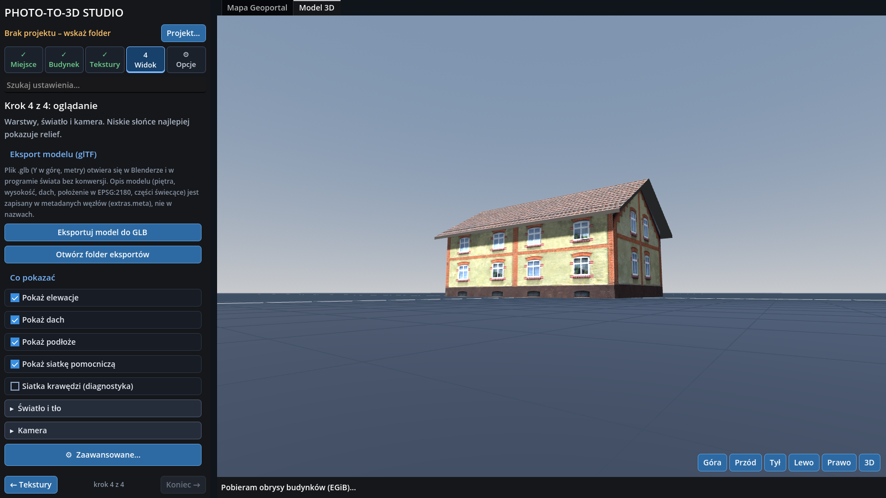
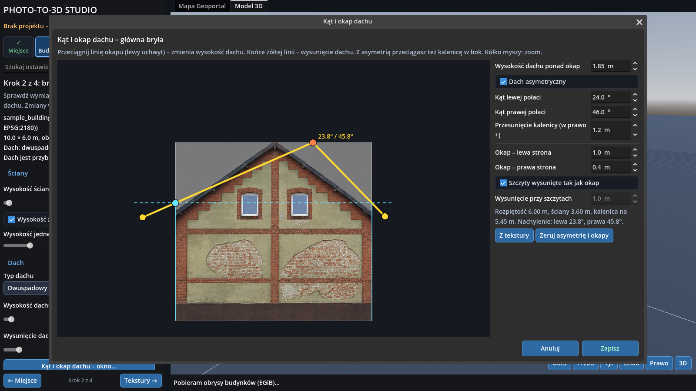

# Photo-to-3D Studio

**Turn real photos and public geodata into ready-to-use 3D objects.**

Pick a building on the Polish [Geoportal](https://www.geoportal.gov.pl) map, get its footprint from the land-and-building
register (EGiB) and the orthophoto, generate a 3D model, then texture it from photos of the real building. Photos are cleaned
up and arranged into one texture sheet by an AI image model, the program cuts the sheet, maps it onto the walls and roof,
lets you correct every surface by hand and exports **glTF/GLB with a metadata layer** (floors, heights, roof, EPSG:2180
placement, materials, windows and doors) for game engines, Blender or your own pipeline.



## What it does

- **Geodata → shape.** Footprints and orthophoto from Geoportal.gov.pl (WMS/WFS, EPSG:2180), multi-part buildings (main body +
  annexes), place search with history, local cache and request throttling.
- **Walls and a separate roof solid.** Gable/flat roof, eaves overhang, thickness, per-part heights, **asymmetric roofs**
  with a dedicated roof editor (angle, ridge position, per-side overhang).
- **Photo → texture sheet.** The program writes a complete prompt for ChatGPT plus colour-tag frames: ChatGPT draws every wall in a frame of its own colour anywhere on the canvas and the program cuts, rescales and lays them out by itself. The layout is a 4096² one computed from the real wall sizes (one frame per wall in its true proportions, packed tightly, the highest common px/m scale that fits),
  and reads back a JSON description (material class, condition, colour, windows and doors).
  The idea is *photo-texturing*: GPT should **correct the visible wall, not invent a new one**; the program warns when the
  number of windows on the sheet differs from the source photo.
- **Chimneys.** A generator window with a plan view and two elevations: type width, length and height, drop the chimney on the roof,
  slide it along the slope and raise it; the shaft wears a repeated cut-out of a wall picture. Exported as separate nodes with metadata.
- **Automatic slicing** of the returned sheet into wall/gable/roof panels (also when panels touch or the sheet has another size).
- **Per-surface correction.** Click a wall or roof slope: move/scale/rotate the picture, pick another panel, crop a piece,
  adjust material (roughness, specular, metallic, relief, emissive), raise the eaves. A full-window mapping editor works like
  *Unwrap UVW* in 3ds Max, including perspective rectification of a real photo.
- **Export.** GLB (Y up, metres) plus `<project>.meta.json`. The mesh is only visualisation, the meaning lives in metadata
  (see [docs/MODEL_META.md](docs/MODEL_META.md) – a draft contract open for review).

| roof editor | surface correction |
|---|---|
|  |  |

## Quick start

1. Install **Godot 4.6** (standard build, not .NET): <https://godotengine.org/download>
2. Godot Project Manager → **Import** → `project.godot` → **Import & Edit** → **F5**.
3. Choose a project folder, find a place, click a building, **Build model**, then follow the cards
   *Place → Building → Textures → View*.

Needs internet access (Geoportal, Nominatim) and a Vulkan GPU (or `--rendering-method gl_compatibility`).
The UI is currently in **Polish**.

## Building executables

`export_presets.cfg` has ready presets (Windows x64, Linux x86_64, single file with embedded data). Install the Godot 4.6.3
export templates (Editor → Manage Export Templates), then:

```
godot --headless --path . --export-release "Windows" build/windows/GeoStudio.exe
godot --headless --path . --export-release "Linux"   build/linux/GeoStudio.x86_64
```
Prebuilt files are attached to the releases. The Windows build is unsigned, so SmartScreen may warn on first start.

## Documentation

- [docs/DOKUMENTACJA.md](docs/DOKUMENTACJA.md) – full user and tester guide (Polish): workflow, every window, test scenario, limitations.
- [docs/MODEL_META.md](docs/MODEL_META.md) – metadata contract of the exported model (draft).
- [docs/ARCHITECTURE.md](docs/ARCHITECTURE.md) – code layout.
- [docs/CHANGELOG_NOTES.md](docs/CHANGELOG_NOTES.md) – feature notes from the development history.

## Status

Working prototype (v2). Honest list of what is **not** verified yet: the live Geoportal and Nominatim endpoints were developed
against a mock server; GLB import in Blender / other engines and Windows paths have not been tested; roofs are simplified
gable/flat/shed (no LoD2); windows and doors are described in metadata but are not separate geometry; AI-generated sheets do not
guarantee the number or layout of windows. Details in [docs/DOKUMENTACJA.md](docs/DOKUMENTACJA.md#12-znane-ograniczenia).

## Tests

```
godot --headless --path . --import
godot --headless --path . --script res://tools/selftest.gd      # 265 checks, exit code 0 = OK
```
`tools/mock_geoportal.py` + `tools/e2e_mock.gd` run the whole flow against a fake Geoportal.

## Data and licence

Geodata © GUGiK / Geoportal.gov.pl – check the service terms before publishing results made with it.
The sample textures in `textures/` and `textures/samples/` are demo material; make sure you have the right to redistribute them
before making the repository public. **Add a `LICENSE` file** (code licence of your choice) before publishing.
