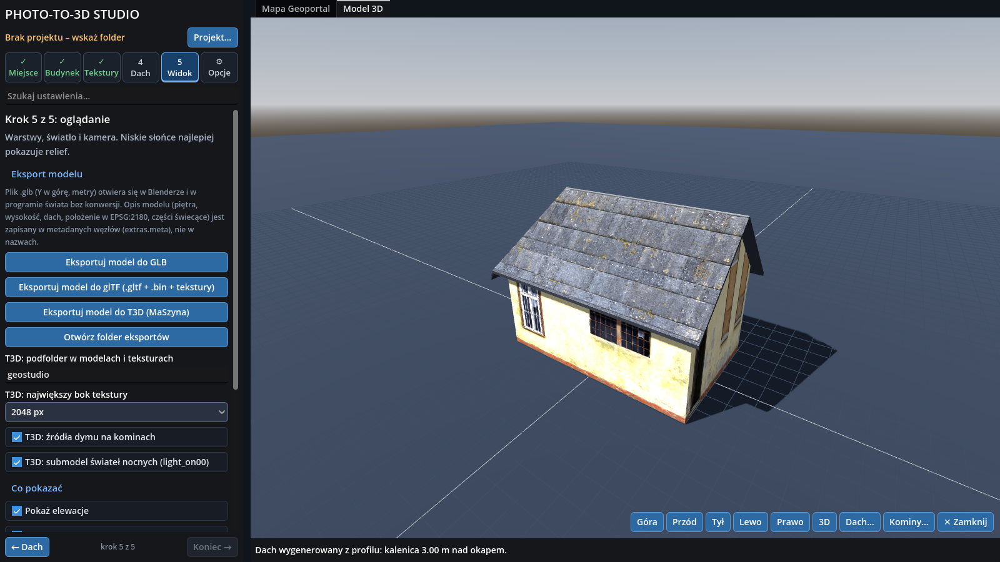
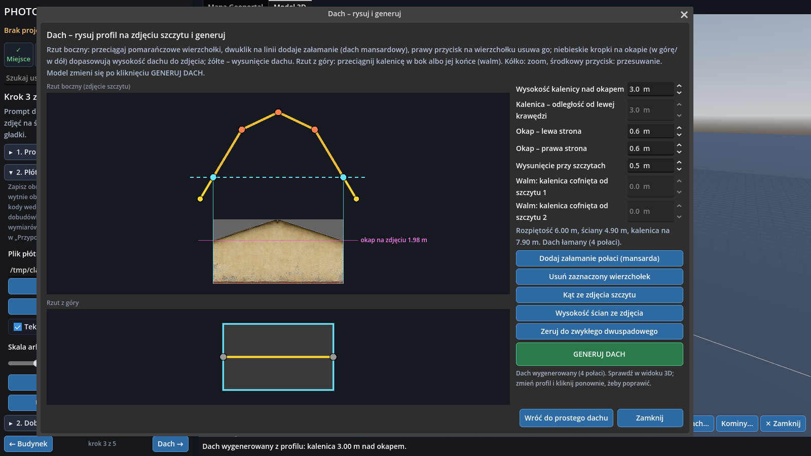

# Photo-to-3D Studio (GeoStudio) v3

*English version: [README.md](README.md)*

**Zamień zdjęcia i dane publiczne w gotowe obiekty 3D.**

Wskaż budynek na mapie [Geoportalu](https://www.geoportal.gov.pl), pobierz jego obrys z ewidencji (EGiB) i ortofotomapę, zbuduj model 3D
i oteksturuj go ze zdjęć rzeczywistego budynku. Zdjęcia czyści i układa w jedno płótno ChatGPT (prompt generuje program), program tnie płótno, nakłada
na ściany i dach, pozwala poprawić każdą powierzchnię, narysować dach na zdjęciu szczytu i postawić kominy. Eksportuje **GLB/glTF z metadanymi**
oraz **T3D dla symulatora MaSzyna**. Cały projekt zapisuje w jednym pliku **`.mgdot`**.

> **Przeznaczenie.** GeoStudio to narzędzie dedykowane tworzeniu modeli dla symulatora **MaSzyna**, w szczególności dla **MaSzyna Reloaded** (wersja na silniku Godot).
> Służy do szybkiego budowania obiektów scenerii (domy, zabudowania, kominy) na podstawie prawdziwych miejsc. Eksport GLB/glTF jest dodatkiem do innych zastosowań; głównym celem jest eksport T3D.



## Co potrafi

- **Geodane → bryła**: obrysy i ortofotomapa z Geoportal.gov.pl (EPSG:2180), budynki wieloczęściowe, własny GeoJSON, wyszukiwarka miejsc, cache.
- **Ściany i osobna bryła dachu**; **generator dachu** rysowany na prawdziwym zdjęciu szczytu (dwuspadowy, mansardowy, naczółki).
- **Zdjęcia → tekstura**: prompt dla ChatGPT (8 sektorów, jedna skala px/m, bez JSON), automatyczne wycinanie sektorów, kody S1–S8, układ w skali rzeczywistej, edytor paneli.
- **Kominy** z generatora z trzema rzutami; **edytor UV** każdej powierzchni (jak Unwrap UVW), prostowanie zdjęć.
- **Podgląd krawędzi i wierzchołków** jak „Edged Faces” w 3ds Max (grubość w px, kolor, zasłonięte bledsze).
- **Eksport**: GLB, glTF (`.gltf` + `.bin` + tekstury), **T3D dla MaSzyny** (LOD0/LOD1, TGA + MAT, `.inc`, nodebank, dym z kominów).
- **Projekt `.mgdot`**: zapis i otwieranie całej sceny w jednym pliku, lista ostatnich plików.



## Szybki start

1. Pobierz `GeoStudio-windows.zip` lub `GeoStudio-linux.zip`, rozpakuj i uruchom (nie wymaga instalacji; exe nie jest podpisany).
   Albo ze źródeł: Godot **4.6** (standardowy) → Import → `project.godot` → **F5**.
2. Wskaż folder projektu (albo otwórz plik `.mgdot`), znajdź miejsce, kliknij budynek, **Zbuduj model 3D**.
3. Karty: *Miejsce → Budynek → Tekstury → Dach → Widok*. W *Teksturach* skopiuj prompt do ChatGPT, dołącz zdjęcia, zapisz wynik i wskaż go jako „Płótno od GPT”.

Internet potrzebny jest tylko w kroku „Miejsce” (Geoportal, Nominatim). Interfejs programu jest **po polsku**.

## Budowanie programu

`export_presets.cfg` ma gotowe presety (Windows x64, Linux x86_64, jeden plik z danymi). Zainstaluj szablony eksportu Godot 4.6.3, potem:

```
godot --headless --path . --export-release "Windows" build/windows/GeoStudio.exe
godot --headless --path . --export-release "Linux"   build/linux/GeoStudio.x86_64
```

## Dokumentacja

- [docs/PODRECZNIK.pl.md](docs/PODRECZNIK.pl.md) – podręcznik użytkownika i testera (PL); [docs/MANUAL.en.md](docs/MANUAL.en.md) – to samo po angielsku.
- [docs/FORMATS.md](docs/FORMATS.md) – formaty `.mgdot`, glTF i **T3D** (PL + EN).
- [docs/MODEL_META.md](docs/MODEL_META.md) – docelowy kontrakt metadanych: profil generatora nad formatem modeli MaSzyna Reloaded (PL + EN). [docs/MODEL_META_V1.md](docs/MODEL_META_V1.md) – to, co eksporter zapisuje dziś.
- [docs/ROADMAP.md](docs/ROADMAP.md) – roadmapa (PL + EN).
- [docs/ARCHITECTURE.md](docs/ARCHITECTURE.md) – układ kodu (PL + EN). [docs/CHANGELOG.md](docs/CHANGELOG.md) – historia zmian.

## Prace w toku – kolejne kroki

- **Cała sekcja metadanych** (`docs/MODEL_META.md`, blok `model_meta`, dane per część, odczyt po stronie symulatora) wymaga jeszcze przepracowania i dokończenia.
- **Wycinanki na panelu** (płótno sektorów) pod kątem elementów udających świecenie – podświetlone okna, lampy, powierzchnie `light_on` – wymagają dopracowania: sposób wycinania, oznaczania i eksportu do T3D (obecnie neutralne `light_on00` bez maski).

## Status – co jest, a czego nie sprawdzono

Działający prototyp (3.0.4). **Nie sprawdzono**: eksportu T3D w samym symulatorze MaSzyna (format odtworzono z paczki przykładowej i kontroli automatycznych), importu GLB/glTF w Blenderze i innych silnikach,
pracy na Windows (ścieżki), żywych usług Geoportalu i Nominatim (rozwijane na atrapie serwera). Dach to uproszczony model, nie LoD2; okna i drzwi nie są osobną geometrią;
ChatGPT nie gwarantuje liczby okien ani rozmiaru obrazu. Pełna lista: [podręcznik, rozdz. 13](docs/PODRECZNIK.pl.md).

## Testy

```
godot --headless --path . --import
godot --headless --path . --script res://tools/selftest.gd      # 342 sprawdzeń, kod wyjścia 0 = OK
```

## Dane i licencja

Geodane © GUGiK / Geoportal.gov.pl – sprawdź warunki usługi przed publikacją wyników. Próbki tekstur w `textures/` to materiał demonstracyjny;
upewnij się, że możesz je rozpowszechniać, zanim opublikujesz repozytorium.

Kod jest na licencji **MIT** – patrz [LICENSE](LICENSE). © 2026 Miłosz „pol102” Mindak. Supported by Claude AI.
