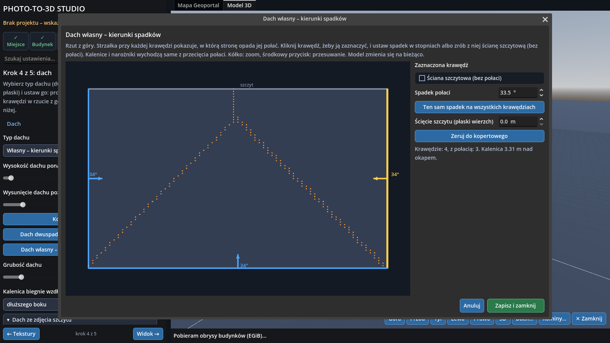
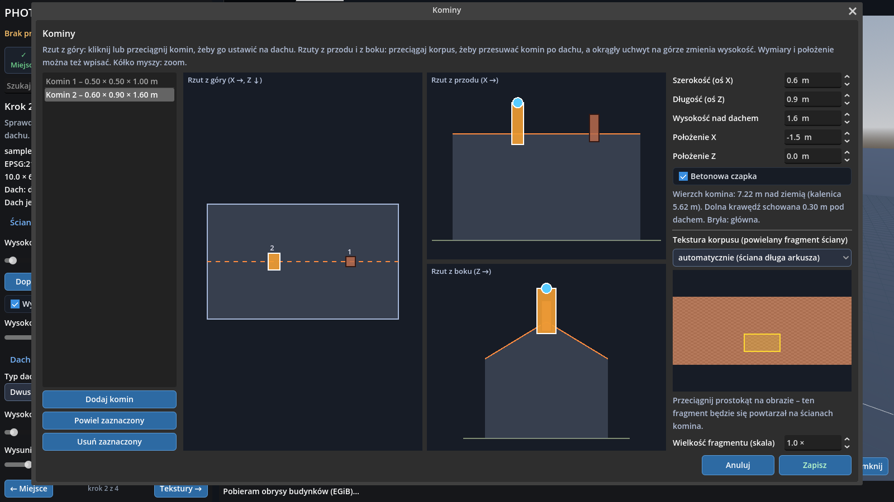
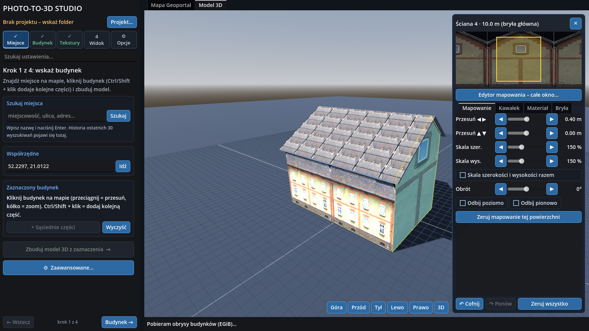
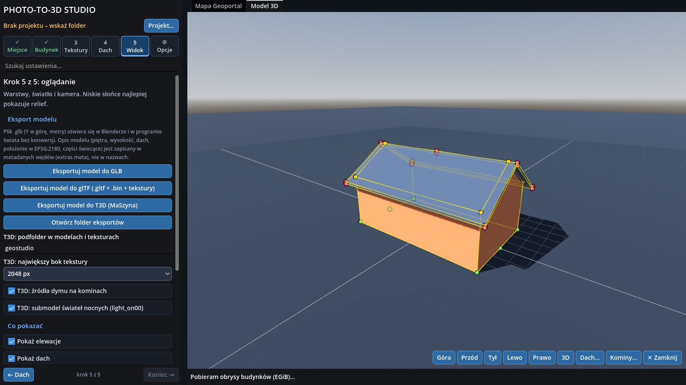

# Photo-to-3D Studio (GeoStudio) v3 – user manual

*Wersja polska: [PODRECZNIK.pl.md](PODRECZNIK.pl.md)*

Program version: **3.0.2** (Godot 4.6). This manual covers the whole path "building from the map → 3D model → texture from ChatGPT →
roof → chimneys → export (GLB / glTF / T3D) → `.mgdot` project file" and what to check while testing.
**Note:** the program interface is in Polish; button and section names are quoted in Polish with a translation in brackets where it helps.

---

## 1. What the program does

> GeoStudio is made for building models for the **MaSzyna** train simulator, in particular **MaSzyna Reloaded**. T3D is the primary export; GLB/glTF is secondary.

1. You pick a building on the **Geoportal.gov.pl** map (footprint from the Polish land-and-building register EGiB + orthophoto) or load your own GeoJSON outline.
2. The program builds a 3D solid: walls and a **separate roof solid** (eaves overhang, thickness, underside).
3. It writes a **prompt for ChatGPT**. From your photos ChatGPT makes one 4096 × 4096 px **canvas** with eight sectors (S1–S8: walls, gables,
   roof, annexes), every picture straightened, cleaned and at one scale.
4. You point the program at that canvas. It cuts the pictures out of the sectors (or frames), assigns the codes S1–S8, lays them out at real size
   and maps them onto walls and roof. Every surface can be fixed by hand (UV editor).
5. In the **Dach** (roof) tab you draw the roof profile **on the photo of the gable wall** (gable, mansard, hips) and press  (generate roof).
   The **chimney** generator puts chimneys on the roof.
6. Export: **GLB** and **glTF** (with metadata) and **T3D for the MaSzyna train simulator** (models, TGA textures + MAT, .inc file, nodebank entry).
7. The whole state is saved as one **`.mgdot`** file (a zip under its own extension) that opens on any computer.

Moving files to and from ChatGPT by hand is **intentional** – the program does not talk to the OpenAI API.
Data: © GUGiK / Geoportal.gov.pl – check the service terms before publishing results.

## 2. Requirements and start-up

- **Ready-made program**: `GeoStudio-windows.zip` (GeoStudio.exe) or `GeoStudio-linux.zip` (GeoStudio.x86_64). Unpack and run, there is no installer.
  The exe is unsigned, so SmartScreen may warn on first start.
- **From source**: Godot **4.6** (standard build, not .NET) → Project Manager → **Import** → `project.godot` → **F5**.
- A Vulkan GPU, or `godot --rendering-method gl_compatibility`.
- Internet (Geoportal, Nominatim place search) is needed for step 1 only; the rest works offline (GeoJSON, `.mgdot` projects).

The window starts full screen; **F11** toggles it.

## 3. Projects: folder and .mgdot file

At start the program asks for a **project**. The start window offers **Wskaż lub utwórz folder…** (pick or create a folder), **Otwórz plik projektu (.mgdot)…**
(open a project file) and lists of recent files (with thumbnails) and folders.

You work in a **project folder** (saved automatically); the **`.mgdot` file** is its portable single-file copy.

```
<project>/
  project.json         state: outlines, settings, texture and panels, roof, chimneys, UV edits, map position
  geo.txt / geo.json   Geoportal data (attributes, EPSG:2180 outlines, services, time)
  geo/ortho.png        orthophoto crop
  texture/             GPT canvas, laid-out sheet <name>_arkusz.jpg, <name>.atlas.json, prompt_gpt.txt, rectified/
  renders/             lastView_<time>.png written on exit (newest 3 by default)
  exports/             glb, gltf/, t3d/
  project.log          timestamped events
```

### Saving and opening `.mgdot`

- **Projekt → Zapis i pliki projektu → Zapisz projekt (.mgdot)** asks for a name the first time and then saves to the same place. **Zapisz projekt jako…** (save as) always asks.
- **Projekt → Zapis i pliki projektu → Otwórz projekt / zmień folder…** or the start window – pick a `.mgdot` file or choose it from the recent list.
  The program unpacks it into `<name>_projekt` next to the file and opens it. If that folder was unpacked from exactly this save it is reused
  (no second unpacking); if the file is newer, `<name>_projekt_2` etc. is created – nothing is ever overwritten.
- Writing is **atomic**: the file is written as `.tmp` and replaces the old one only when complete, so a crash cannot destroy the previous version.
- A file from a **newer format version** is refused with a message; so is a damaged or foreign zip.
- `exports/` and `renders/` are not packed (they can be regenerated); a thumbnail and the prompt used (`prompt.txt`) are. Details: [FORMATS.md](FORMATS.md).

## 4. Screen layout and controls

The left **side panel** has the tabs **1 Miejsce (place) → 2 Budynek (building) → 3 Tekstury (textures) → 4 Dach (roof) → 5 Widok (view)** and the two side tabs **⚙ Emitery (emitters)** and **⚙ Projekt (project: save, open, program settings)**.
A finished step shows ✓. Building, Textures and Roof stay locked until a model is built. The **Szukaj ustawienia…** field searches all tabs.
A changed setting shows an orange **↺** (click = restore the default). Rare settings live in the **⚙ Zaawansowane…** (advanced) window (Save / Cancel).

| gesture | map | 3D view |
|---|---|---|
| left button drag | pan | orbit the camera |
| wheel | zoom | zoom |
| middle button | – | pan the scene |
| click | pick a building (Ctrl/Shift: add/remove a part) | pick a wall or roof slope |
| `F11` | full screen | |
| `Esc` | closes a window / deselects the surface | |
| `Ctrl+Z`, `Ctrl+Y` | | undo / redo a surface edit |

Buttons at the lower right of the 3D view: Góra/Przód/Tył/Lewo/Prawo (top/front/back/left/right orthographic views), **3D**, **Dach…**, **Kominy…**, **✕ Zamknij**
(saves the project and quits).

## 5. Step 1 – Place

1. **Szukaj miejsca** (search: town or address + Enter; history of 30 searches) or **Współrzędne** (`52.2297, 21.0122`).
2. Click a building on the map (outlines appear at zoom ≤ 2 m/px). EGiB cuts buildings into polygons: **Ctrl/Shift + click** adds/removes a part,
   **+ Sąsiednie części** adds the touching ones.
3. **Zbuduj model 3D z zaznaczenia →** (build the model). The largest polygon is the main body, the rest are annexes.
4. Alternative: the **Obrys z pliku GeoJSON** section – import your own outline or **Załaduj przykładowy budynek (L)** (sample L-shaped building).

Orthophoto and outlines are cached locally; requests go through a queue with retries on 429/503 (Projekt → Połączenie z Geoportalem).

## 6. Step 2 – Building

- **Ściany (walls)**: height by hand or from the EGiB number of floors × storey height. The register often under-states the height, hence the button
  **Dopasuj wysokość ścian do proporcji tekstury** (wall height = wall length / aspect of panel S1).
- **Parts**: each body has its own wall height, roof type and roof height; ↺ = automatic, ✕ = remove the part.
- ⚙ Advanced: annex proportions, shed roof of annexes, merge tolerance, alignment of the outline to the axes.

## 7. Step 3 – Textures (the ChatGPT flow)

### 7.1 Prompt for GPT

**1. Prompt dla GPT → Generuj prompt dla GPT…** opens a window with the ready text and a **Kopiuj** (copy) button; a copy is kept in `texture/prompt_gpt.txt`.
The prompt is computed from the building dimensions and **contains no JSON** (the window/door description was removed – ChatGPT could not keep to it). It contains:

- register data (outline, height to the eaves, roof, floors, annexes),
- the **canvas layout**: 4096 × 4096 px, **8 sectors** of 2048 × 1024 px (2 columns × 4 rows), numbered by rows from the top; one element per sector,
  in its top-left corner, 16 px from the edge, on #808080 grey,
- **one scale** for the whole canvas (112 px/m by default; less if the long wall does not fit 2048 px),
- the codes: **S1** long wall A (front), **S2** long wall B, **S3/S4** gables (rectangle with a triangular top) or short walls, **S5** roof (one slope seen from above),
  **S6–S8** annexes and other walls; empty sectors stay empty,
- "STEP 0 – INVENTORY BEFORE DRAWING" (number of windows, doors, cornices), the overriding rule "correct the photo, do not draw a new one", a ban on skipping elevations,
  walls ending at the eaves line, the roof as pure texture, clean-up (sky, people, gutters, bushes).

In ChatGPT paste the prompt, **attach the building photos** and save the generated image.

### 7.2 Canvas from GPT

**2. Płótno od GPT**: point to the saved file (or **Wybierz z podglądem…**, pick with preview). A copy goes to `texture/`. The program recognises two kinds of canvas:

- **Sector canvas** (recommended, what the prompt asks for): 2 × 4 sectors. ChatGPT sometimes draws a light frame around a sector – the program skips it. From each sector it trims
  the background and cuts out the picture; the code comes from the sector number (S1…S8); an empty sector is skipped.
- **Red-frame canvas** (older way): 2 px frames around every picture, codes from shape and position (heuristic).

The program then **lays the pictures out at real scale** (using the EGiB dimensions) into the sheet `texture/<name>_arkusz.jpg` and cuts it into regions. The sheet is written as
JPG quality 97 % (encoding a 4096² PNG took about 7 s). The result is **remembered**: loading the same file again with the same panels and dimensions skips the analysis.
The status line says how many panels were found and which are missing.

- **Przyporządkuj panele…** (assign panels) – editor: change a panel's code, move/resize its frame (drag), add a panel (drag on empty space), **Usuń panel**, **Wykryj ramki ponownie**. Manual fixes are stored in the project and take priority.
- **Skala arkusza (px/m)** – the scale of the laid-out sheet; set automatically.
- **Podgląd cięcia na regiony…** – shows the regions and their names. **Usuń teksturę** – model without textures.
- Texturing works "like a box without a roof": walls get S1–S4, the roof separately (S5, or the roof generator – see below).
- **A wall picture covers the whole wall** (no hidden tiling or cropping). Repetition appears only from a surface edit (scale < 100 %).

### 7.3 Other sections of the tab

- **Dobór na ściany i dach** (assignment) – "Automatycznie" or a specific picture per wall; **Następny wariant**, **Losuj tekstury** (random).
- **Relief** – a normal map from photo brightness (strength for walls and roof separately, detail, smoothing, parallax); **Eksportuj mapy normalnych (PNG)**.
- **Skala i materiał**, **Biblioteka zdjęć** (plain photos as separate textures), **Cięcie arkusza (zaawansowane)** – automatic slicing parameters, **Przeanalizuj obraz ponownie**.

A custom atlas JSON (`textures/atlas_wroniawy.json` is the example) still works as a source.

## 8. Step 4 – Roof and chimneys

### 8.1 Roof type and the "Dach" section
**Typ dachu** (roof type): *Dwuspadowy* (gable), *Kopertowy (4 połacie)* (hip, four slopes), *Własny – kierunki spadków* (custom – slope directions), *Płaski* (flat). Plus height above the eaves, overhang, thickness and ridge direction.
**The roof height field always works**: also on a drawn roof (the profile is scaled) and on a custom roof (the slopes are scaled). Changing the type replaces a previously drawn roof.
Fields with ↺ keep a fixed slot – the panel layout no longer jumps when you change a value.

### 8.2 "Dach dwuspadowy – profil na zdjęciu szczytu…" (gable roof – profile on the gable photo)


The window has a **side view** (top) and a **top view**. The side view shows the **real photo of the gable wall** (panel S3 or S4) at true scale – you draw the roof
on it instead of guessing. The program measures the eaves line (pink) and the apex on the picture. Without a gable picture (a canvas without S3/S4, or no texture loaded) the background is grey with the note "brak zdjęcia szczytu" (no gable picture).

- **Profile vertices** (orange, up to 7): drag; double-click on a line adds a break (mansard); right-click removes.
- **Blue dots on the eaves**: dragging up/down fits the roof height to the picture. **Yellow ends** – roof overhang; fields: left/right eaves, gable overhang.
- **Top view**: drag the ridge sideways or its ends (hips).
- **Kąt ze zdjęcia szczytu**, **Wysokość ścian ze zdjęcia**, **Zeruj do zwykłego dwuspadowego**.
- **Changes are applied to the model at once** (with a short delay after the last change) – there is no "generate" button. `Esc` / × closes the window and **restores the roof it was opened with**; **Zamknij** keeps the changes.

### 8.2a Hip roof and custom roof



- **Kopertowy** (hip): four slopes down to the eaves; the height comes from the "Wysokość dachu" field.
- **Własny – kierunki spadków** (button "Dach własny – rzut z góry, kierunki spadków…"): a window with the top view of the building. Every edge has an **arrow**
  showing which way its slope runs, with the angle in degrees. Click an edge (yellow = selected), set its **spadek** (slope) or tick **Ściana szczytowa** (gable wall: an edge without a slope).
  Orange dots show the computed ridges and hips. **Ścięcie szczytu** makes a flat top at the given height. **Ten sam spadek na wszystkich** / **Zeruj do kopertowego** speed things up.
  The rule: the slope of every edge rises from its eaves line inwards, and the roof is the lower envelope of all slopes (this is how hip, gable, pyramid and half-hip roofs all arise).
  Edges at concave corners (an L-shaped outline) are skipped. Changes show on the model at once; `Esc` / **Anuluj** restores the previous roof.

### 8.3 Chimney generator
A window with a top view and two side views: **Dodaj / Powiel / Usuń** (add / duplicate / delete) a chimney, typed dimensions (width, length, height above the roof, X and Z position),
dragging along the roof and a height handle, a **concrete cap**, a **shaft texture** (select a rectangle on a wall picture – that fragment is repeated; choose plain brick without a window).
The chimney base sinks 30 cm below the roof. **Zapisz** confirms, **Anuluj** restores. Chimneys are saved in the project and go to the exports (GLB: `chimney_<n>` nodes; T3D: smoke sources).



## 9. Fixing a single surface (UV editor)

Click a wall or slope in the 3D view. The panel on the right: **Mapowanie** (mapping: offset, scale, rotation, flips), **Kawałek** (another panel or a cut-out fragment repeated on the surface),
**Materiał** (colour, roughness, specular, metallic, relief, the **Świeci** glow flag), **Bryła** (raise the eaves or the ridge).



The **Edytor mapowania – całe okno** works like "Unwrap UVW": **Wycinek** mode (a frame on the picture) and **Prostowanie zdjęcia** (photo rectification: four corners on a real photo → a flat image saved in `texture/rectified/`).
`Ctrl+Z`/`Ctrl+Y` undo and redo. Edits belong to a specific outline and are cleared when another building is built.

## 10. Step 5 – View and export

### Model export

| button | result |
|---|---|
| **Eksportuj model do GLB** | `exports/<name>.glb` + `<name>.meta.json` (Y up, metres) |
| **Eksportuj model do glTF** | `exports/gltf/<name>/<name>.gltf` + a `.bin` file + textures (PNG) + `.meta.json` |
| **Eksportuj model do T3D (MaSzyna)** | `exports/t3d/<name>/` – see [FORMATS.md](FORMATS.md) |
| **Otwórz folder eksportów** | opens the exports folder |

The **Eksport jako paczka ZIP** checkbox (above the buttons): after every export a `.zip` archive is written next to the files (GLB: `<name>.zip` with the GLB and meta; glTF and T3D: a zip of the whole folder). The loose files stay.

T3D options (in the same section): sub-folder (e.g. `mieszkalne`), maximum texture side (512–4096, default 2048), smoke sources on chimneys,
night-light submodel. Metadata description: [MODEL_META.md](MODEL_META.md).

### Edge and vertex display (like "Edged Faces" in 3ds Max)



- **Krawędzie siatki** (mesh edges) – the shaded model with its edges drawn on top. The edges are real geometry drawn in screen space, so they have a **thickness in pixels**
  (1.6 px by default), any **colour** and **opacity**. Visible edges are strong, **hidden ones paler** (slider "Widoczność krawędzi zasłoniętych", 0 = hidden).
- **Pokaż wierzchołki** (show vertices) – points of constant screen size with an outline. The colour shows the kind: green – footprint at ground level, orange – upper wall corners,
  red – roof and chimneys. Size, outline thickness and all colours are in the **Krawędzie i wierzchołki** section.
- **Pokaż przekątne trójkątów** (show triangle diagonals) – hidden by default (you see wall and slope edges, not the triangulation).

Further: **Co pokazać** (show: walls, roof, ground, helper grid), **Światło i tło** (light and background), **Kamera**, **Podłoże i siatka** (ground and grid).

### Emitters tab (draft)
The **Emitery** tab adds places on the model that can give off light, sound or smoke: **light – surface** (window, sign), **light – point**, **light – spot** (lamp), **audio – omni**, **audio – directional**, **smoke – chimney**. They are *data only* (nothing is cut out of the mesh): small markers show them in the 3D view and they are saved in the project (`.mgdot`) and in the export metadata (`emitters`, `channels`). A **channel** is a named input that switches a group of emitters (e.g. `swiatla` lights all windows); channels are created automatically from the names you type. Draft contract: [MODEL_META.md](MODEL_META.md). A surface light is placed by wall number, distance from the wall start, height and size; the provisional surface id `p<part>:w<wall>` will be reworked when `surfaces[]` is implemented. Not verified in MaSzyna Reloaded.

## 11. Options

**Projekt** (save/open `.mgdot`, render, project folder), **Program** (font size, full screen, reset settings), **Połączenie z Geoportalem** (service URLs, **Testuj usługi** = test services), **Cache** (validity, size, parallelism).

## 12. Test scenario (about 25 minutes)

1. Start: the project window; pick a new folder.
2. **Załaduj przykładowy budynek (L)** (Place → outline from file) or pick a building on the map. Build the model. The tabs unlock.
3. Textures → **Generuj prompt** → check there are 8 sectors S1–S8, the px/m scale, no JSON. Make the canvas in ChatGPT, save it, point to it in **2. Płótno od GPT**.
   Check the status ("Płótno od GPT: n paneli"), **Przyporządkuj panele…**, **Podgląd cięcia**. Loading the same file again must be instant.
4. Roof: **Dach – rysuj i generuj…** – the gable photo at true scale; drag vertices, add a break and a hip; ; check the 3D model.
5. **Kominy – generator…**: add a chimney, place it in the top and side views, choose a wall fragment, Zapisz.
6. Click a wall: move/scale, change the panel, photo rectification, Ctrl+Z/Y.
7. View: switch on **Krawędzie siatki** and **Pokaż wierzchołki**; change thickness and colours.
8. Export: GLB (Blender), glTF (`.gltf` + `.bin`), T3D (directory structure, nodebank entry). Optionally load the T3D in the simulator.
9. **Zapisz projekt (.mgdot)**, quit, start again, open the file from the recent list: model, texture, roof, chimneys and edits come back.

**What to report**: steps to reproduce, a screenshot, `project.log`, the GPT canvas (if the problem is about slicing or texture).

## 13. Known limitations and what was not verified

- **To be worked on next:** (1) the whole **metadata section** (`model_meta`, per-part data, [MODEL_META.md](MODEL_META.md)); (2) the **panel cut-outs** for elements that imitate lighting (lit windows, lamps, `light_on` surfaces) – cutting, marking and the T3D export (now a neutral `light_on00` without a mask).
- **The T3D export was not checked in the MaSzyna simulator itself.** The format was rebuilt from the sample pack (cottages, street lamps) and checked automatically (vertex order,
  normals, tangents, file layout). To be confirmed in the simulator: the direction of the texture V axis, smoke-source names with several chimneys, `light_on00` without a window mask, the `normalmap_specgloss` shader with neutral maps.
- The connection to the **live** Geoportal and Nominatim was developed against a mock server; if the map is empty: Projekt → Połączenie z Geoportalem → Testuj usługi.
- EGiB gives a footprint and sometimes the number of floors; the roof is a simplified model (a generator profile), not LoD2.
- **ChatGPT does not guarantee** the number of windows, the image size or proportions. The program cuts and scales what it gets; a wall picture is stretched over the whole wall.
- Windows and doors are not separate geometry (the JSON opening description was removed); the glow (`emissive`, `light_on00`) applies to a whole surface.
- Chimneys: axis-aligned boxes without slanted joints to the roof; the repeated wall fragment shows seams.
- Not verified: importing GLB/glTF into Blender and other engines, running on Windows (paths), assemblies with more than 6 parts.
- Map coordinates are 32-bit `Vector2` (about 6 cm at EPSG:2180 values); positioning in the metadata is computed in double precision.

## 14. Automated tests

```
godot --headless --path . --import
godot --headless --path . --script res://tools/selftest.gd      # 342 checks, exit code 0 = OK
```
They cover: projection, settings, frame and sector detection, sheet layout, prompt generator, roof profile, chimneys, GLB/glTF export, **T3D export**
(vertex order, normals, LODs, TGA), the **`.mgdot` format** (packing, unpacking, `../` protection, format versions), the edge overlay. Geoportal mock: `tools/mock_geoportal.py` + `tools/e2e_mock.gd`.
`tools/*_shot.gd` scripts take screenshots (`SHOT_DIR=...`). Architecture: [ARCHITECTURE.md](ARCHITECTURE.md).
